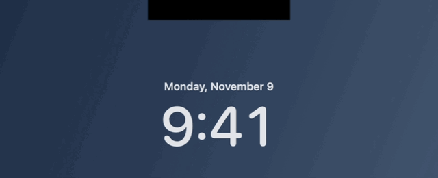

# FaceLatch

MacBook 내장 카메라로 얼굴을 확인하는 macOS 메뉴 막대 앱입니다. 잠금 화면의 노치 아래에 얼굴 아이콘이 나타나고, 얼굴이 일치하면 초록색 체크와 짧은 성공음을 재생한 뒤 macOS에 로그인 암호를 제출합니다.



*앱의 모션을 별도 미리보기 창에서 캡처했습니다. 이 시연에서는 카메라를 사용하지 않으며, 실제 인증은 수행하지 않습니다.*

## 빌드

macOS 26 및 Swift 6.2 이상이 필요합니다. Xcode 또는 Command Line Tools를 설치한 뒤 실행하세요.

```sh
bash build.sh
open dist/FaceLatch.app
```

메뉴 막대에서 **잠금 해제 모션 미리보기**를 선택하면 모델 없이도 모션과 효과음을 확인할 수 있습니다. **실제 잠금 화면 모션 테스트…**를 선택한 다음 Control–Command–Q를 누르면 잠금 화면에서도 모션만 테스트할 수 있습니다.

## 얼굴 인식 설정

1. [InsightFace 모델 이용 조건](https://github.com/deepinsight/insightface#license)을 확인하고, 사용 권한이 있는 `w600k_mbf.onnx`를 준비하세요. 기본 변환 대상은 `buffalo_s`의 얼굴 인식 모델입니다. 이 저장소는 가중치를 배포하지 않습니다.
2. 모델을 Core ML로 변환하고 앱을 다시 빌드하세요.

   ```sh
   python3 -m venv .venv
   source .venv/bin/activate
   python -m pip install -r tools/requirements.txt
   python tools/convert_arcface.py --onnx-path /path/to/w600k_mbf.onnx
   bash build.sh
   open dist/FaceLatch.app
   ```

3. 메뉴 막대에서 **얼굴 등록…**을 선택하고 카메라를 허용하세요. 미리보기 원 안에 얼굴을 맞춘 뒤 **얼굴 인식 테스트**로 확인할 수 있습니다.
4. **Mac 잠금 해제 켜기…**를 선택하고 손쉬운 사용 권한을 허용한 뒤 Mac 로그인 암호를 입력하세요. 잠금 화면에서 카메라를 보면 얼굴이 일치할 때 잠금 해제를 시도합니다.

모델은 기본적으로 저장소 루트의 `ArcFace.mlpackage`에서 읽습니다. 다른 위치를 쓰려면 `FACELATCH_MODEL_PATH`를 지정하세요. 빌드는 기본적으로 임시 서명합니다. 재빌드 때 권한을 다시 허용해야 한다면 `FACELATCH_SIGNING_IDENTITY`에 자신의 코드 서명 인증서 이름이나 지문을 지정하고 같은 인증서로 계속 빌드하세요.

## 동작과 제한

- 얼굴 등록 정보와 로그인 암호는 실행 중 메모리에만 보관합니다. 앱을 종료하면 다시 등록해야 합니다.
- 일반 RGB 카메라를 사용합니다. 사진이나 영상이 통과할 수 있으므로 보안이 중요한 환경에는 적합하지 않습니다.
- 로그인한 세션의 잠금 화면에서 동작합니다. 재시동이나 로그아웃 후 첫 로그인은 macOS에서 직접 해야 합니다.
- 노치 패널은 비공개 SkyLight API를 사용하므로 macOS 업데이트에 따라 표시가 달라질 수 있습니다. 효과음은 해당 파일이 있는 Mac에서 시스템 결제 성공음을 재생합니다.

## 출처

얼굴 검출·정렬, 모델 연결, 잠금 상태 확인, 키 입력 및 오버레이 코드와 모델 변환 도구는 [Glance](https://github.com/jonnyoo/glance/tree/b97f521)를 바탕으로 수정했습니다. Glance의 MIT 라이선스는 [LICENSE](LICENSE)에 있습니다. 모델 이용 조건은 [InsightFace](https://github.com/deepinsight/insightface#license)를 따릅니다.
